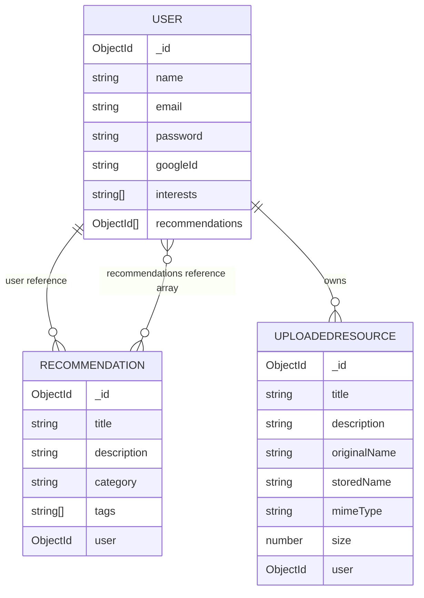

# Database Documentation

## Database Connection

The API connects with Mongoose using `MONGO_URI`. For MongoDB Atlas, configure the Atlas connection URI as the backend environment variable and allow the deployed backend to connect in the Atlas network access settings. The server falls back to `mongodb://127.0.0.1:27017/personalized_recommendation_system` if `MONGO_URI` is missing. That fallback is suitable only when a local MongoDB server is available; it is not evidence that the deployed service uses Atlas.

The live API health route does not check the database connection. The actual production URI and connection status are not visible in the repository and have not been independently verified.

## Collections

Mongoose's default model-name pluralization maps the models to these collection names:

| Model | Collection | Timestamps |
|---|---|---|
| `User` | `users` | `createdAt`, `updatedAt` |
| `Recommendation` | `recommendations` | No timestamps configured |
| `UploadedResource` | `uploadedresources` | `createdAt`, `updatedAt` |

### User

Defined in `server/models/User.js`.

| Field | Type | Constraints / behavior |
|---|---|---|
| `name` | String | Required |
| `email` | String | Required and unique |
| `password` | String | Required; registration stores a bcryptjs hash |
| `googleId` | String | Optional; sparse index |
| `interests` | Array of strings | Defaults to an empty array |
| `recommendations` | Array of ObjectId references | References `Recommendation` |
| `createdAt`, `updatedAt` | Date | Added by Mongoose timestamps |

The model has no profile-editing interface in the current frontend. Password data is not excluded by the schema from generic user query responses, so the current public `/users` routes should not be treated as safe for real user records.

### Recommendation

Defined in `server/models/Recommendation.js`.

| Field | Type | Constraints / behavior |
|---|---|---|
| `title` | String | Required |
| `description` | String | Required |
| `category` | String | Required |
| `tags` | Array of strings | Defaults to an empty array |
| `user` | ObjectId reference | Required; references `User` |

Recommendation records are queried with `.populate("user")` on list and detail operations. The model defines no timestamps.

### UploadedResource

Defined in `server/models/UploadedResource.js`.

| Field | Type | Constraints / behavior |
|---|---|---|
| `title` | String | Required, trimmed, maximum 120 characters |
| `description` | String | Trimmed, maximum 500 characters, defaults to an empty string |
| `originalName` | String | Required; original uploaded filename |
| `storedName` | String | Required and unique; generated filename stored on disk |
| `mimeType` | String | Required |
| `size` | Number | Required; byte size |
| `user` | ObjectId reference | Required; references `User` |
| `createdAt`, `updatedAt` | Date | Added by Mongoose timestamps |

## Relationships

Both `User.recommendations` and `Recommendation.user` store references. The relationship is represented by stored ObjectIds and populated by selected query handlers; it is not a MongoDB relational foreign-key constraint. `UploadedResource.user` associates the metadata with its owner. File contents are not stored in MongoDB.

## Data Lifecycle Notes

- Email/password registration hashes the password with bcryptjs before saving.
- Google sign-in creates or links a user record after ID-token verification; the schema still requires a password value.
- Resource upload writes the binary to the API server's upload directory, then stores metadata in MongoDB.
- Deleting a resource removes the metadata and attempts to remove the associated disk file.
- AI suggestions are not stored in any collection.
- No migration or seed script is included in the documented project structure.
