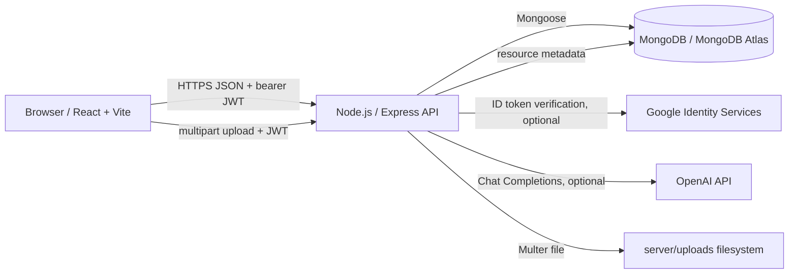

# System Architecture

## Overview

The project is a browser-based React application backed by an Express API. MongoDB persistence is accessed through Mongoose. The backend also integrates with Google token verification and OpenAI when the corresponding credentials are configured. Multer accepts resource uploads and saves file bytes to the backend filesystem.

## Components

### Frontend

The React application is under `client/src/`. `App.jsx` controls the home, registration, and login views. Components provide authentication, resource upload/list management, AI recommendations/autocomplete, and recommendation cards. `api.js` reads the API origin from `VITE_API_URL` and provides the shared email/password request helper.

The browser stores the JWT in local storage and sends it in the `Authorization: Bearer <JWT>` header for protected operations. The checked-in `client/.env.production` points the client to the provided Render backend.

### Backend

`server/server.js` configures Express JSON parsing, CORS, static serving for `/uploads`, Mongoose, Multer, and route handlers. `server/Middleware/authMiddleware.js` verifies JWTs for protected routes. `server/models/` defines the User, Recommendation, and UploadedResource models.

### Persistence and file storage

Mongoose persists user records, recommendation records, and uploaded-resource metadata in MongoDB collections. Resource bytes are written to `server/uploads/`; the database stores a generated filename and metadata. No cloud object-storage integration is configured in the source.

### External services

- **OpenAI:** The AI endpoints call the Chat Completions API. The recommendation request asks for up to four results; autocomplete returns up to five topic suggestions. These AI results are returned to the frontend, not persisted.
- **Google:** If both Google client ID values are set, the frontend obtains a credential and the backend verifies the ID token with `google-auth-library`. Otherwise, Google sign-in is not configured.

## Request Flows

### Email and password sign-in

1. The client posts registration details to `/auth/register`.
2. The API hashes passwords with bcryptjs before creating a user document.
3. The client posts credentials to `/auth/login`.
4. The API compares the password hash and signs a JWT with a one-hour expiry.
5. The client stores the token and includes it with protected requests.

### Resource upload

1. The client submits a multipart form with `title`, optional `description`, and `file`.
2. JWT middleware identifies the user; Multer validates the allowed MIME types and 5 MB size limit.
3. The API stores the file in its uploads directory and creates metadata with a reference to the authenticated user.
4. Listing and deletion are scoped to that user. Static files are served under `/uploads/`.

### Topic-based suggestions

1. A signed-in user enters an interest or topic in the client.
2. The client can debounce and send a topic autocomplete request.
3. On submission, the client sends the chosen topic to the recommendation endpoint.
4. The API validates the input, calls OpenAI using the backend key, filters the response, and returns JSON results.
5. The client displays those results; there is no persistence step in this flow.

### Recommendation records

The client requests the protected recommendation feed and displays stored records. Recommendation create, read, update, and delete endpoints exist. However, the UI does not create records directly, and the API's recommendation update/delete handlers do not enforce record ownership.

## Deployment and Configuration

- The backend Render blueprint is defined in `render.yaml`; its health-check path is `/health`.
- The frontend production API origin is defined in `client/.env.production`.
- `CLIENT_URL` controls the configured CORS origin. The code's fallback when it is absent is permissive.
- `MONGO_URI` selects the database. If omitted, the code uses a local MongoDB fallback; the actual hosted Atlas URI is a Render environment value and cannot be inspected from the repository.
- `JWT_SECRET` is required at backend startup.
- `OPENAI_API_KEY` and Google client IDs are required only for their respective integrations.
- The backend health endpoint reports process responsiveness only; it does not test MongoDB or external services.

## Current Limitations Relevant to Architecture

- Uploads are stored on local disk, which may not be persistent across certain hosting restarts or redeployments.
- The user CRUD endpoints are not JWT-protected.
- Recommendation routes require a JWT but do not restrict access to a user's own recommendation records.
- AI output is transient and not saved.
- The user `interests` field is not currently used for recommendation ranking.
